# OAEF V5 — user guide: from specification to evidence, step by step

**Audience:** test engineers, reviewers and demo drivers. **Scope:** NIN-001 (new adult, no deduplication hit), synthetic S1 journey observed through real Tempo, Loki and Prometheus (S2-read). Nothing here is a MOSIP verification.
**Figures:** every screenshot below comes from GitHub Actions run [42420471946](https://github.com/gharbonnier78/mosip-observability-oracles/actions/runs/42420471946) (commit `0f9f3fc`, 2026-11-07), taken by the Playwright script `validation/demo/capture_screens.py`, not by hand and not by an AI.
**Companion documents:** live demo [runbook](OAEF-V5-LIVE-DEMO-RUNBOOK.md) (timed script, recovery, run records), [compiler design](../oaef/OAEF-V5-SPEC-COMPILER-DESIGN.md), [cycle status](../oaef/OAEF-V5-CYCLE-STATUS.md), process models in [`docs/process/`](../process/).

---

## 0. The lifecycle in one picture

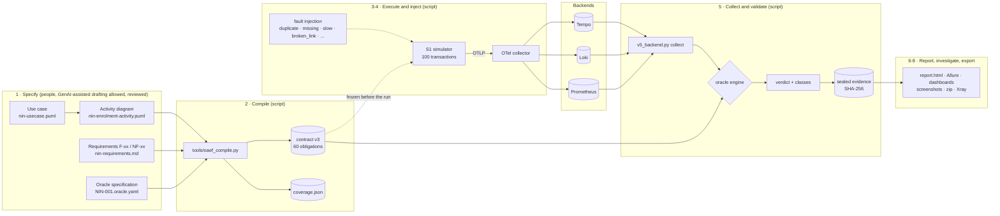

*Figure 1 — Lifecycle. Only box 1 is written by people; boxes 2 to 8 are scripts with fixed inputs: the same inputs give the same verdict.*

| Step | Who / what | Command | Output |
|---|---|---|---|
| 1. Specify | person (author, reviewer) | edit `models/`, `oracles/` | reviewed, committed specification |
| 2. Compile | script | `python3 tools/oaef_compile.py` | `generated/contracts/NIN-001.contract.json`, `generated/coverage.json` |
| 3. Execute | script (S1 simulator) | `run_v5_demo.sh nominal` or CI | OTLP traces, logs, metrics tagged `oaef.run.id` |
| 4. Inject faults | script | `run_v5_demo.sh duplicate missing slow broken_link ...` | the same journey with one known defect on TX-017 |
| 5. Collect and validate | script | `v5_backend.py collect` (called by the demo script) | `backend-verdict.json`, sealed bundle |
| 6. Investigate | person | open `report.html`, Grafana | diagnosis |
| 7. Stability | script | `OAEF_REPEAT=3 run_v5_demo.sh ...` | runs page STABLE / FLAKY |
| 8. Export | script | automatic at the end of a campaign | campaign zip, Xray Cucumber JSON, Allure, screenshots |

---

## 1. One-time prerequisites

| What | Why | How | Secret handling |
|---|---|---|---|
| Access to the repository | CI, artifacts | GitHub account with write access | — |
| GitHub CLI signed in | start CI runs and fetch results from a workstation or from Claude Code | `gh auth login` (device flow, the user types the code in the browser) | token in the OS keyring, never in the repo or in a prompt |
| Codespace (optional) | interactive demo with Grafana in the browser | open a Codespace on branch `docs/oaef-v5-model-to-evidence-demo`; the stack starts by itself | Codespaces secret `GF_ADMIN_PASSWORD` (not the default `change-me`) |
| Nothing for CI | the live workflow starts its own Grafana | — | random admin password per job, masked in the log |

**Technical user (target for unattended runs).** Today a run is started by a signed-in person. For scheduled or unattended runs, the recommended set-up is a GitHub App (or machine account) with `actions:write` and `contents:read` on this repository only, its key held in the organisation's vault (e.g. HashiCorp Vault or Azure Key Vault) and fetched at run time; Grafana and SUT credentials for S2 come from the same vault through OIDC, never from files. Not implemented yet: S2 item.

---

## 2. Step 1 — Specify (people)

Four files, all versioned. Together they are the **only** human-written input of the cycle.

| File | Content | Used by the scripts as |
|---|---|---|
| `models/nin-usecase.puml` | actors and use cases | documentation (not parsed) |
| `models/nin-enrolment-activity.puml` | activity diagram: lanes, activities, decisions, notes, `[F-xx]` tags | model element ids (`model_element_refs` of each obligation) |
| `models/nin-requirements.md` | traceability table F-01..F-12, NF-01..NF-09 → scenarios → oracle sections | requirement ids and texts (`requirement_refs`) |
| `oracles/NIN-001.oracle.yaml` | the oracle: variables, expected spans (aliases, parents, attributes), links T1→T2→T3, business events in order, logs and forbidden content, metrics, NFR budgets, scenario steps | everything the oracle checks |

Rules of the game:
- The specification is **frozen before the run**. Injected faults never change it.
- Every expected span, event and log names the requirements it proves (`requirements: [F-07]`). Section-level requirements are the default; element-level ones win.
- What the oracle cannot check yet stays in the YAML (REST bodies, DB state, audit, spec metrics). It is compiled into obligations marked **NOT_EVALUATED**, never counted as passed.
- `docs/diagrams/*.drawio` are explanatory drawings (reviewed, GenAI-assisted), **not** read by any script.

## 3. Step 2 — Compile the specification into the oracle contract (script)

```bash
pip install --require-hashes -r requirements-compiler.txt   # PyYAML 6.0.2, hash-pinned
python3 tools/oaef_compile.py            # writes the contract and the coverage
python3 tools/oaef_compile.py --check    # CI: fails if the committed contract is not what the sources give
```

Result for NIN-001: **60 obligations** (20 span aliases, 2 links, 6 ordered business events, logs, NFR budgets, metrics, REST/DB/audit/notification placeholders), each with `requirement_refs` and `model_element_refs`, and the SHA-256 of every source. `generated/coverage.json` lists each requirement with its obligations; **uncovered: F-11, F-12, NF-02** (relying-party auth, child enrolment, capture retries — other scenarios).

Functional and non-functional coverage executed by V5 today:

| Kind | Requirements | Checked from | Example check id |
|---|---|---|---|
| Functional | F-04 packet received / stages, F-05 stages, F-07 exactly one NIN, F-08 activation and credential, F-09 notification | business events (Loki), span tree (Tempo) | `OBL-EVENTS-EV_UIN_ASSIGNED:count` |
| Non-functional, time | NF-04 upload → NIN, NF-05 issuance → notification, span budgets | event timestamps, span durations | `OBL-EVENTS-NF-04:duration`, `OBL-NFR-span_budgets_ms:IDREPO_CREATE_SERVER` |
| Non-functional, signal contract | NF-07 no PII in clear, NF-08 every signal stamped with environment and site | log content, resource attributes | `OBL-LOGS-*`, `OBL-TRACES-COMMON:*` |
| Not evaluated yet | REST (C2), spec metrics M1–M5/ENV/X1 (C3), DB, audit, notification content (C5) | — | reported `NOT_EVALUATED` |

## 4. Step 3 — Execute a campaign (script)

**From a workstation or Claude Code (CI):**

```bash
gh workflow run oaef-v5-live.yml --ref docs/oaef-v5-model-to-evidence-demo -f contract=spec -f "cases=tests s0 nominal duplicate missing slow broken_link missing_metric"
gh run list --workflow oaef-v5-live.yml -L 1
gh run watch <run-id> --exit-status
gh run download <run-id> -n oaef-v5-campaign-zip
```

The workflow starts Grafana LGTM (pinned by digest) on the runner, runs the cases, builds Allure, takes the screenshots, builds the zip and uploads two artifacts: **oaef-v5-reports** and **oaef-v5-campaign-zip**. About 10 minutes for all cases (run 42420471946: 10 min 36 s).

**In a Codespace:** `bash validation/demo/run_v5_demo.sh nominal` (Grafana and reports open on ports 3000 and 8080).

What `nominal` does: 100 synthetic NIN-001 transactions following the MOSIP flow. Per transaction: trace T1 (Jarvis upload → packet receiver → audit → Kafka → 7 stage groups → keymanager, S3 → ID generator → ID repository → status polls), T2 (credential batch, span link to T1) and T3 (IDA callback, link to T2): **42 spans over 15 services, 25 log records of which 14 business events**, plus the journey histogram and per-service HTTP metrics. Every signal carries `oaef.run.id`, `oaef.transaction.id`, `deployment.environment.name`, `cloud.region`.

## 5. Step 4 — Inject faults (script)

Each case changes **one** thing on transaction TX-017 (or one metric) and must be caught with the right class. The expected outcome is asserted by the script; a case that behaves otherwise prints `UNEXPECTED`.

| Case | Injected defect | Expected verdict | Diagnostic class | Check that catches it (live run) |
|---|---|---|---|---|
| nominal | none | PASS | `S1_TELEMETRY_CONFORMANT` | 4401 checks, 0 failed |
| duplicate | `uin.assigned` emitted twice | FAIL | `OBSERVABILITY_VIOLATION` | `OBL-EVENTS-EV_UIN_ASSIGNED:count` 1 → 2 |
| missing | `uin.assigned` not emitted | INCONCLUSIVE | `EVIDENCE_GAP` | `OBL-EVENTS-EV_UIN_ASSIGNED:count` 1 → 0 |
| slow | identity creation 3150 ms | FAIL | `NFR_VIOLATION` | `OBL-NFR-span_budgets_ms:IDREPO_CREATE_SERVER` ≤ 3000 → 3150 ms |
| broken_link | trace context lost before ID repository | FAIL | `TRACE_CONTEXT_BROKEN` | `OBL-TRACES-IDREPO_CREATE_SERVER:parent` (+5 marked *consequence of*) |
| wrong_value | wrong `uin_hash` value | FAIL | `OBSERVABILITY_VIOLATION` | `OBL-EVENTS-*:values` |
| metric_count | one extra histogram count | FAIL | `METRIC_RECONCILIATION_FAILURE` | metric reconciliation |
| missing_metric | ID generator emits no HTTP metric | INCONCLUSIVE | `EVIDENCE_GAP` | 4 service metric checks INCONCLUSIVE |

Why `missing` is INCONCLUSIVE and not FAIL: an absent signal does not prove the business step did not happen. Without an independent source (DB, audit: C5) the honest verdict is "evidence gap".

## 6. Step 5 — Collect and validate (script)

`v5_backend.py collect` (called by the demo script for each case):
1. queries Tempo (each trace of the run), Loki (the run's records, limit derived from the expected volume, truncation guard) and Prometheus (run-scoped series), polling until the evidence is complete or the timeout expires; every attempt is logged;
2. normalises what the backends return (Tempo base64 ids and link ids, enum span kinds; Loki JSON bodies);
3. runs the **same oracle engine** on the retrieved data as on the emitted payload, against the frozen contract;
4. classifies the result (PASS / FAIL / INCONCLUSIVE + classes), writes `backend-verdict.json`, seals every file with SHA-256, publishes an `oaef.test.verdict` event for the dashboards, and writes `report.html` and Allure results.

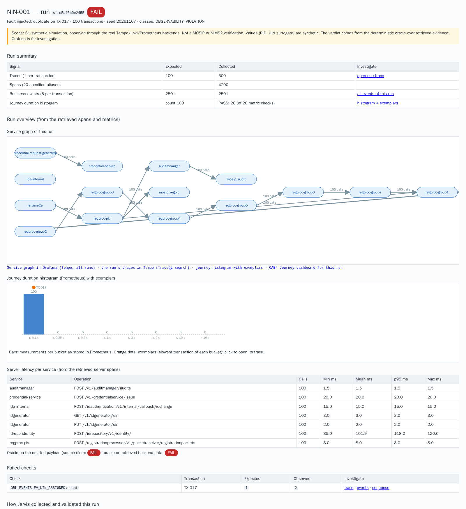
*Figure 3 — `report.html` of the `duplicate` run: verdict, signal counts (expected vs collected), run overview (service graph, journey histogram, latency per service) and the failed check with links to trace, events and sequence.*

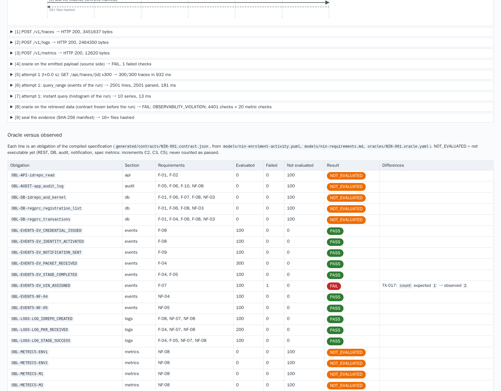
*Figure 4 — How the run was collected (numbered exchanges with Tempo, Loki, Prometheus) and **Oracle versus observed**: one line per compiled obligation with its requirements, evaluated / failed / not evaluated counts and the first difference (`TX-017 count expected 1 → observed 2`).*

## 7. Step 6 — Investigate (person)

From the failed check, follow the links. Each view below opens from the report or from another view.

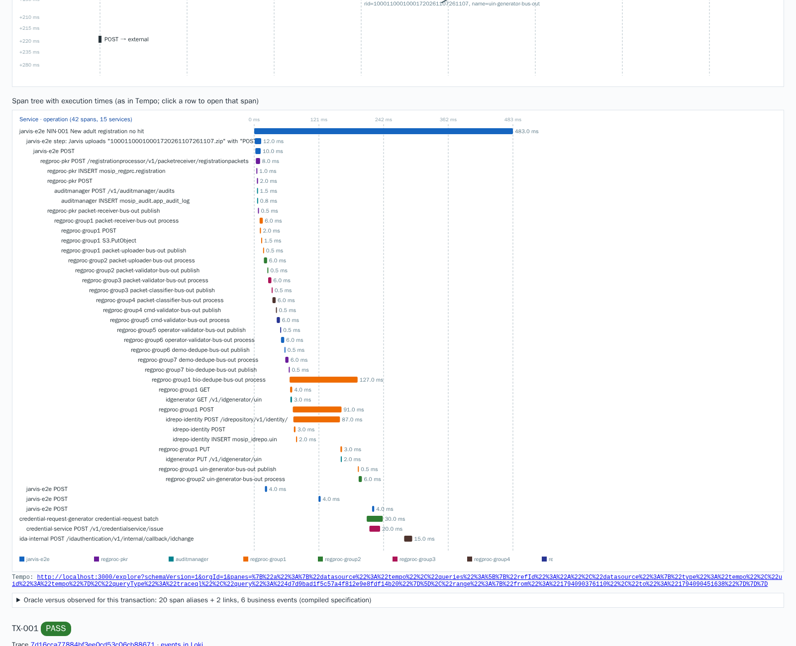
*Figure 5 — Span tree with execution times in the report (42 spans, 15 services), drawn from what Tempo returned; a row opens that span in Tempo.*

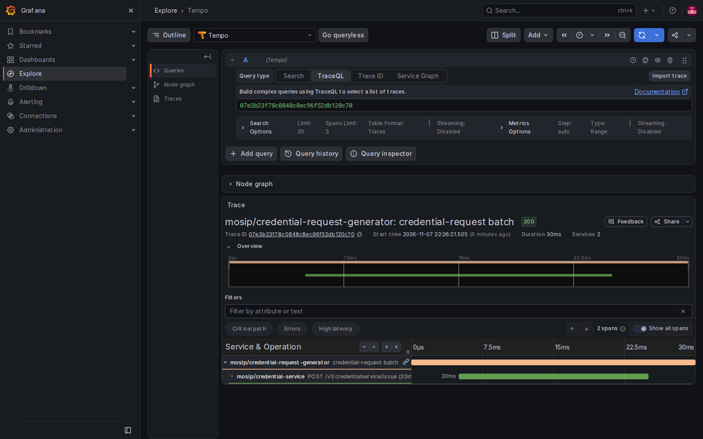
*Figure 6 — The same transaction in Grafana Tempo (T1: 39 spans, 12 services, 483 ms).*

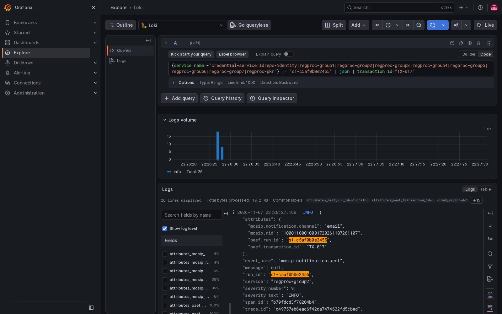
*Figure 7 — Loki: business events and logs of TX-017 in the `duplicate` run (26 lines, one too many `uin.assigned`).*

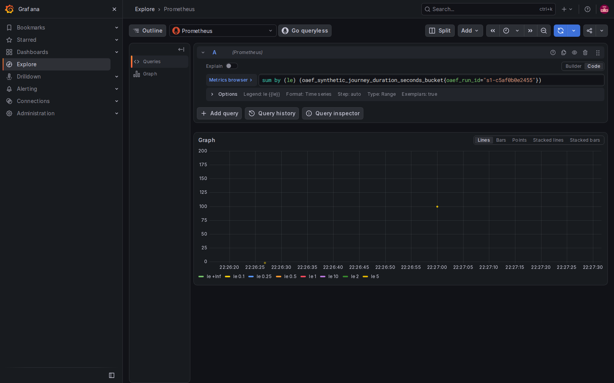
*Figure 8 — Prometheus: journey-duration buckets of the run, exemplars on (an exemplar opens the trace it points to). Navigation aid, not the verdict: the verdict uses exact per-transaction durations.*

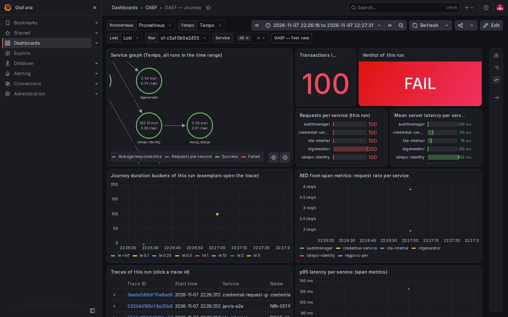
*Figure 9 — Dashboard **OAEF — Journey** filtered on the run: service graph, transactions, verdict, requests and mean latency per service, journey buckets, RED and p95 from Tempo span metrics, the run's traces.*

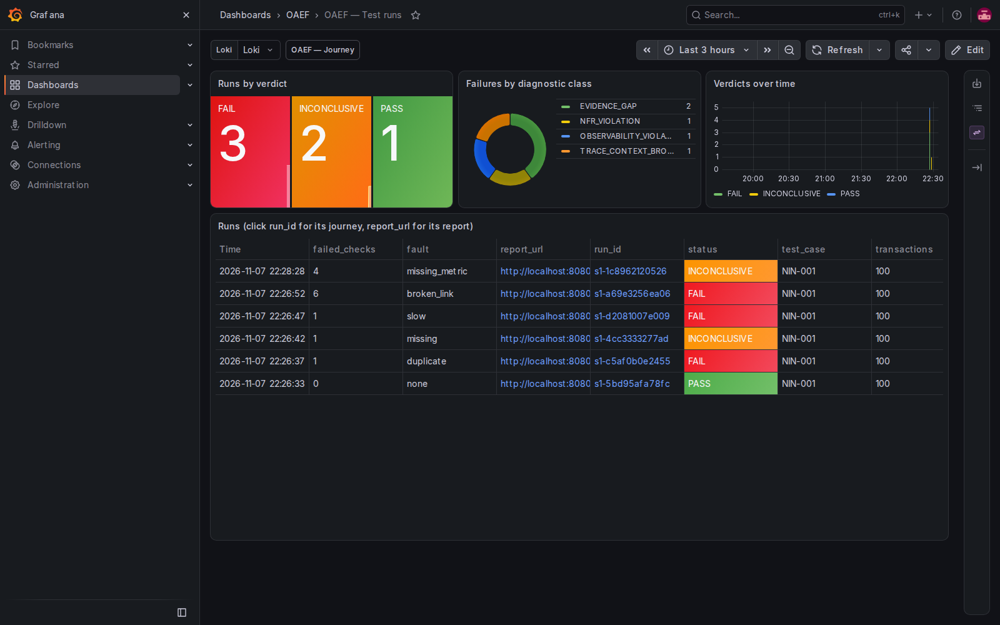
*Figure 10 — Dashboard **OAEF — Test runs**: runs by verdict, failures by diagnostic class, verdicts over time, one row per run with links to its journey and report.*

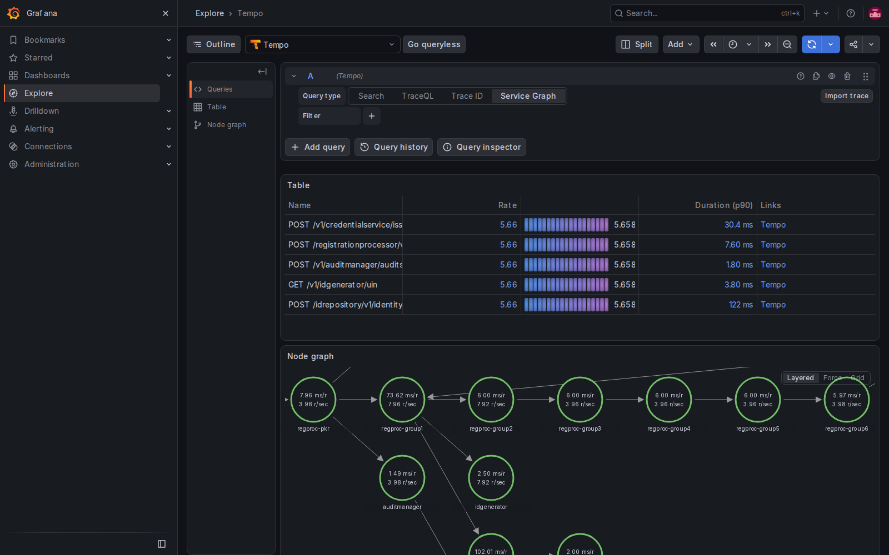
*Figure 11 — Tempo service graph derived from the spans (health view, never evidence).*

## 8. Step 7 — Flaky or defect? (script)

```bash
OAEF_REPEAT=3 bash validation/demo/run_v5_demo.sh nominal duplicate
```

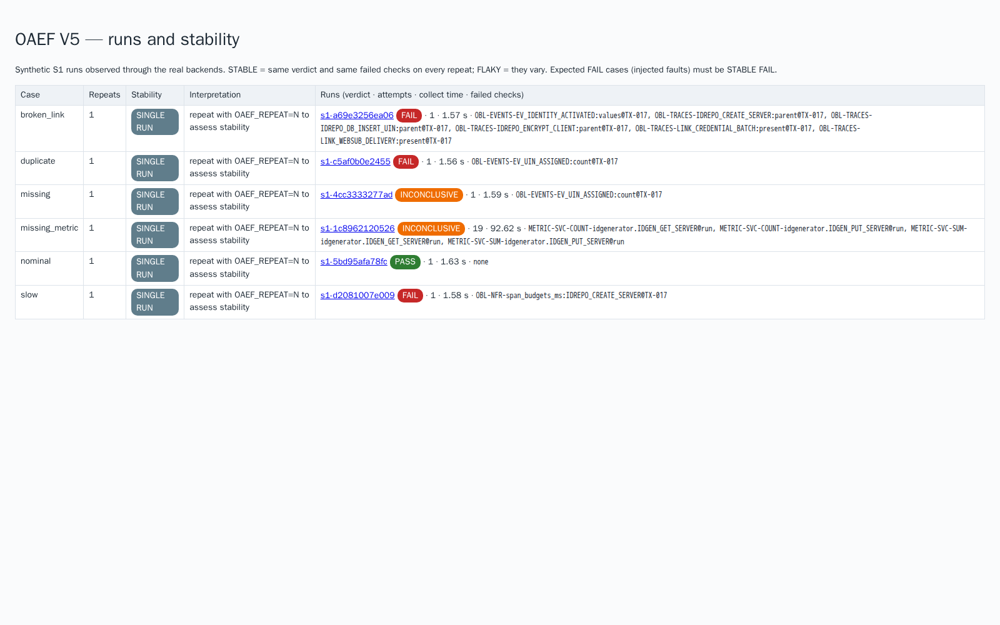
*Figure 12 — Runs and stability page: each case is STABLE (same verdict and same failed checks every time), FLAKY (with the likely cause) or SINGLE RUN. Injected-fault cases must be STABLE FAIL.*

## 9. Step 8 — Evidence, offline zip, Allure, Xray (script)

```bash
python3 validation/v5_backend.py verify-bundle --out <run-folder>   # PASS, or FAIL after any byte change
python3 validation/v5_backend.py re-evaluate   --out <run-folder>   # recomputes the verdict offline: MATCH
```

The campaign zip (`oaef-v5-campaign-<UTC>.zip`, artifact **oaef-v5-campaign-zip**) contains the runs page, every run folder with its report and sealed evidence, the screenshots, the Allure report, the specification sources with the compiled contract and coverage, `xray/cucumber.json` and the SHA-256 of every file. Open `index.html` offline; Grafana links need the original stack.

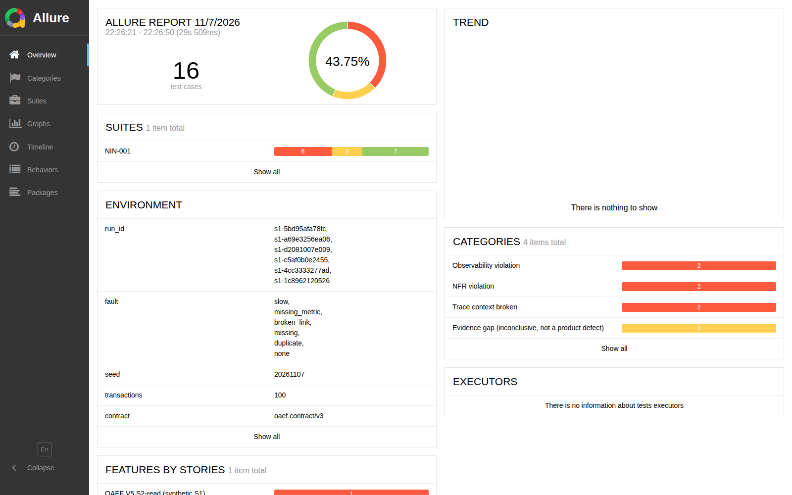
*Figure 13 — Allure report over the campaign: one test per examined transaction plus one per run verdict; categories = diagnostic classes; `EVIDENCE_GAP` results are *broken*, not *failed*.*

**Xray:** import `xray/cucumber.json` as Cucumber results; one scenario per case, steps = the contract's scenario steps with their observed status, `report.html` attached. `OAEF_XRAY_TEST_KEYS="none=PRJ-12,duplicate=PRJ-13"` binds scenarios to existing Tests.

---

## 10. What is GenAI and what is script

| Activity | Done by | Reproducible? | Control |
|---|---|---|---|
| Use case, activity diagram, requirements, oracle YAML | people; drafting may be GenAI-assisted | yes once committed (they are inputs) | human review, versioned, hashed into the contract |
| draw.io diagrams, this guide, the runbook, the deck | people with GenAI assistance (Claude), reviewed | n/a (documentation) | review |
| Code of the compiler, simulator, oracle engine, collector, reports, screenshot script, CI | written with GenAI assistance (Claude Code), reviewed, covered by 33 unit and mutation tests and a regression baseline | yes | tests in CI on every push; `--check` drift test |
| Compile spec → contract | script `tools/oaef_compile.py` | **yes**: same sources → same contract (CI fails on drift) | `generated/` committed, `sources` hashes |
| Generate the journey and inject faults | script `validation/v5_sim_spec.py` (seeded) | **yes**: fixed seed | expected outcome asserted per case |
| Collect from Tempo / Loki / Prometheus | script `validation/v5_backend.py` | **yes** for the verdict; timings vary | per-attempt log, truncation guard |
| Verdict and diagnostic class | script (oracle engine) — **no AI at run time** | **yes**: `re-evaluate` recomputes it offline | sealed bundle (SHA-256) |
| Screenshots | Playwright script in a pinned image | yes (content depends on the live run) | error pages rejected; not part of the evidence |
| Reports, Allure, zip, Xray JSON | scripts | yes | read the sealed verdicts, never recompute them |
| Diagnosis and decision | person | — | the report gives facts and links, not conclusions |
| Demo video narration and navigation | GenAI tool (e.g. Claude Cowork) following a stored script | the script is versioned; the recording is not evidence | `docs/demo/` |

**Rule:** GenAI may help write specifications, code and documents, which people then review and commit. **Nothing in the run path (compile, execute, collect, decide, seal) calls a GenAI model.** A verdict can be recomputed by anyone from the stored evidence.

## 11. Process models (BPMN and ArchiMate)

BPMN-style view of one campaign (the BPMN 2.0 file opens in bpmn.io, Camunda Modeler or any BPMN tool: [`docs/process/oaef-v5-campaign.bpmn`](../process/oaef-v5-campaign.bpmn)):

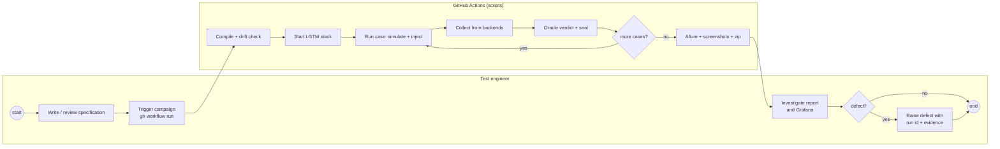

ArchiMate view (layers; the Open Exchange file imports into Archi: [`docs/process/oaef-v5-archimate.xml`](../process/oaef-v5-archimate.xml)):

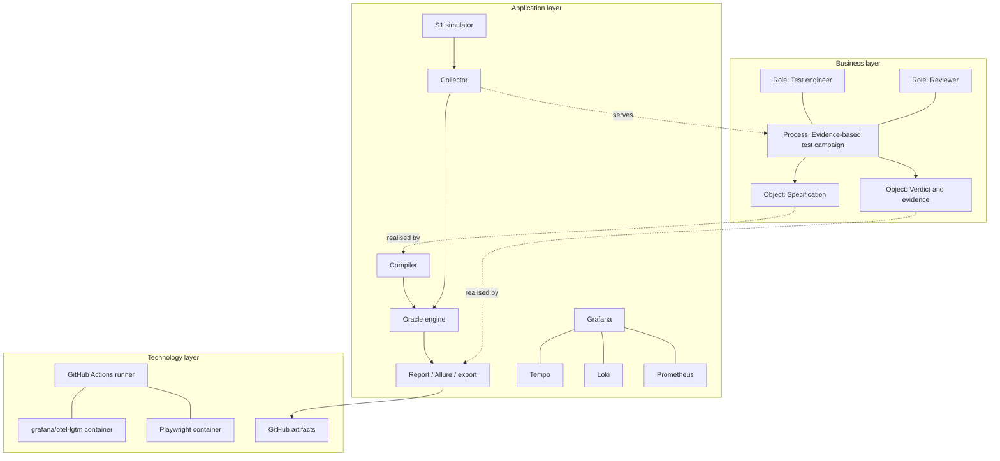

## 12. Limits (say them)

Short version: **the demonstrator proves the testing machinery, end to end, on one path of the model; it proves nothing about MOSIP's behaviour or performance.** The details below are measured against the two specifications a reviewer will hold: the UML models (`models/*.puml`) and the SLA / non-functional register (`models/nin-requirements.md`, NF-01..NF-09). Figures are from run 42420471946.

### 12.1 What kind of evidence this is

| Mode | What is real | What is not |
|---|---|---|
| S1 (simulation) | the oracle, compiled from the specification; OTLP export; the verdict logic | the system: `validation/v5_sim_spec.py` emits the spans, events and metrics the MOSIP flow would emit, with synthetic identifiers and simulated durations |
| S2-read (backends) | Tempo, Loki, Prometheus ingest, store and return the signals; the verdict is recomputed on what they return | the source is still the simulator |
| S2 (target) | the same contract on an instrumented MOSIP platform with API, DB and audit evidence | not done |

The simulator and the oracle are written by the same team. Two safeguards keep a PASS meaningful: the simulator is written from the MOSIP flow, not from the contract, and every fault case must be caught with the right class (§5). They show that the oracle **detects** deviations; they cannot show that a real MOSIP **conforms**.

### 12.2 Against the UML models

**Use case diagram** (`nin-usecase.puml`, deck slide 19). Not parsed: it is documentation. NIN-001 exercises *Upload packet*, *Deduplicate identity* (as regproc stage spans only), *Issue NIN and VID*, *Notify resident* (as a business event only). Not exercised: *Capture biometrics*, *Introduce child* (F-12), *Adjudicate duplicate* (F-06), *Verify NIN* (F-11), *Consult audit trail* (F-10).

**Activity diagram** (`nin-enrolment-activity.puml`, slide 20), lane by lane:

| Lane | Activities | In the simulated journey | Checked by the oracle |
|---|---|---|---|
| Resident | arrive, keep RID slip, receive NIN | no (human steps) | no |
| Enrolment station | capture demographics, biometrics (quality, retries, exception), supervisor approval and RID slip, offline queue, sync and upload | **upload only**: Jarvis plays the station and starts at the upload | upload spans and events; capture, approval, offline queue: no station telemetry |
| Central platform | validate packet, assign NIN and VID, activate identity and issue credential | yes: packet receiver, audit call, Kafka, 7 stage groups, keymanager, S3, ID generator, ID repository, credential batch (T2), IDA callback (T3) | span tree, links, events, logs, durations; NIN/VID **format and check digit not checked** (synthetic values, C2) |
| ABIS | demographic and biometric deduplication | only as `demo-dedupe` / `bio-dedupe` stage spans; no ABIS IDENTIFY request/response | stage spans present and successful; no candidate list, no ABIS round trip |
| Adjudicator | manual adjudication | no | no |
| Messaging gateway | send NIN by SMS and email in the chosen language | only the `mosip.notification.sent` event | event present, NF-05 delay; no notifier span, no message content, no language (NF-09) |

**Decisions** of the activity diagram and the branch NIN-001 takes:

| Decision | Branch taken | Branches never executed (scenario families, C4) |
|---|---|---|
| Quality reached? | yes | no after retries → biometric exception (F-02, NF-02) |
| Packet valid? | yes | no → reject with reason, notify (F-04, F-09) |
| Possible match? | no | yes → adjudication (F-05, F-06) |
| Duplicate confirmed? | not reached | yes → reject, no NIN consumed; no → NIN |

**Traceability is not path coverage.** Each obligation's `model_element_refs` is derived from the requirement tags written on the activities. So an obligation tagged F-04 also points to *Reject with reason*, an activity NIN-001 never goes through. The refs say which part of the model a check is about, not that the path was executed. Path and branch coverage needs the activity paths enumerated from the model (C4, XMI from Modelio).

**Sequence and signal sheets** (draw.io pages 3–4, slides 24–25). Simulated: upload, Kafka hand-off, stages, ID generator, ID repository, credential batch and IDA callback joined by span links. Not simulated: ABIS IDENTIFY over JMS, notifier HTTP call, Jarvis status poll returning `PROCESSED` from a real API, VID authentication. The signal sheet's audit column (PACKET_RECEIVER, UIN_GENERATOR, …) is compiled but not evaluated (C5).

### 12.3 Against the SLA / non-functional specification

All bracketed targets in the register are **assumptions [A]** to be confirmed by the authority; none is a contractual SLA yet.

| Req. | Target [A] | What the oracle checks | Status in the live run | Why it does not prove the SLA |
|---|---|---|---|---|
| NF-01 | station session ≤ 15 min | — | not covered | no station telemetry (journey starts at upload) |
| NF-02 | ≤ 3 capture retries | — | not covered (uncovered in `coverage.json`) | no capture spans |
| NF-03 | offline ≥ 72 h, no loss | compiled refs only | not evaluated | no offline queue simulated; would need an offline scenario |
| NF-04 | upload → NIN ≤ 24 h | `OBL-EVENTS-NF-04:duration`, `packet.received` → `identity.activated` ≤ 86 400 s, every transaction | **executed**, 100/100 pass | durations are simulated (whole T1 ≈ 0.5 s), so passing says nothing about MOSIP; the end point (identity activated vs "NIN") must be confirmed |
| NF-04 (contract) | upload → `PROCESSED` ≤ 600 s | `OBL-NFR-e2e_upload_to_processed_s` | not evaluated | needs the status API (C2) |
| NF-05 | notification ≤ 15 min after issuance | `OBL-EVENTS-NF-05:duration` ≤ 900 s | **executed**, pass | same: simulated time; notification only as an event |
| span budgets | PKR ≤ 5 s, uploader ≤ 30 s, ID repository create ≤ 3 s, ID generator ≤ 500 ms | `OBL-NFR-span_budgets_ms` per alias, every transaction | **executed**, 400 checks; `slow` case caught (3150 ms > 3000 ms) | these budgets are oracle-author assumptions, not in the register: each needs an owner and a source SLA |
| NF-06 | DR: RPO ≤ 15 min, RTO ≤ 4 h | site attribute `cloud.region` on every signal | partly: stamping only | single site (dc1); no failover, no replication measurement |
| NF-07 | no PII in clear; audit immutable | identifiers and contacts forbidden in business events (`OBL-EVENTS-FORBIDDEN:pii`) | **executed** on events; span-attribute rule (`OBL-NFR-security`) not evaluated | values are synthetic; audit immutability needs the audit stores (C5) and WORM |
| NF-08 | signal contract 100 %, env and site on every signal | common span rules (ids, env, cluster, site, env id), span tree, links, events, logs | **executed** | measured on the simulator's output; collector-side stamping and real agents not exercised |
| NF-09 | 4 notification languages | — | not covered | no notification content (C5) |
| infra | 0 pod restarts, Kafka lag back to 0 | `OBL-NFR-infra_window_checks` | not evaluated | no Kubernetes or Kafka in S1 |

Further points a reviewer will raise, and the current answer:

- **Per transaction, not percentile.** The oracle applies each time target to **every** transaction (a maximum). The register does not say whether an SLA is a maximum, a p95 or a mean, nor under which load. This must be agreed with the authority before any SLA verdict counts.
- **No load model.** 100 transactions are emitted in seconds with no concurrency, saturation or soak. This is a functional and evidence demonstrator, not a performance test; the journey histogram is a navigation aid, not a capacity measurement.
- **Clocks.** Cross-service durations assume synchronised clocks. In S1 there is one clock; in S2 the tolerated skew must be specified and checked.
- **A missing signal stops the SLA check.** If an event that bounds a duration is missing, the duration cannot be measured and the verdict is INCONCLUSIVE (evidence gap), never PASS.

### 12.4 Oracle and verdict limits

- **2000 of about 6400 checks per run are NOT_EVALUATED:** REST and business rules (C2), the specification metrics M1–M5, ENV1–2, X1 (C3), DB state, audit and notification (C5), the status-based and infra NFRs. They are reported, never counted as passed.
- **Golden values** (`$golden`, e.g. the audit event catalogue) need an approved reference run, which exists only for a real platform.
- **Verdict classes.** The contract defines the seven classes of deck slide 15 (PASS, PASS_OBSERVABILITY_DEFECT, INCONCLUSIVE, INFRA, SILENT_FAILURE, TEST_DATA_CONFIG, PRODUCT_BUG). The engine produces PASS / FAIL / INCONCLUSIVE with six diagnostic classes. Distinguishing infrastructure from product needs infra checks and error spans from a real system (C6).
- **Evidence integrity.** Each bundle is hashed (SHA-256) and can be re-evaluated offline; it is not signed, and storage is not write-once.
- **Scope of runs.** One scenario of about 45 (NIN-001) with 8 fault variants; the fault variants are telemetry and oracle mutations, not catalogue scenarios.
- Screenshots, dashboards and the video are views; the verdict is in the sealed bundle.

### 12.5 What closes each limit

| Limit | Closed by |
|---|---|
| REST bodies, NIN/VID/RID rules, status API, `e2e_upload_to_processed_s` | C2 |
| specification metrics, environment labels, exemplar link | C3 |
| unexecuted branches and other use cases (reject, adjudication, exception, child, verify NIN, offline, DR) | C4: paths from the model (XMI), generated scenarios |
| DB before/after, audit (F-10, NF-07), notification content and language (NF-09) | C5 |
| seven verdict classes, infra window, first source | C6 |
| SLA definitions (maximum or percentile, load, end points), budget ownership | specification review with the authority |
| real behaviour and real performance | S2 on an instrumented MOSIP, with a load profile |
| signature and write-once storage | evidence platform (later) |
